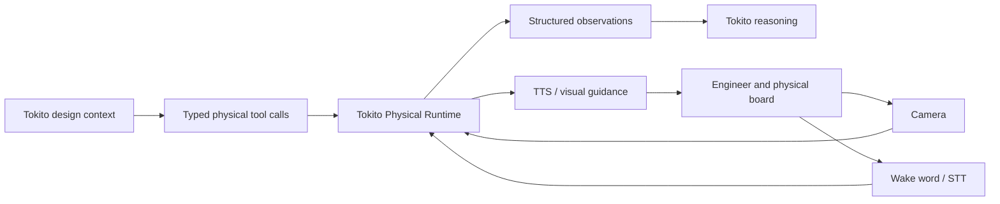

# Tokito Physical Runtime

On-device physical intelligence for electronics engineering: camera perception,
speech, structured observations, and bench tools that let Tokito compare a
digital design with the board on an engineer's desk.

This repository is deliberately separate from
[`tokito-companion`](https://github.com/TokitoAI/tokito-companion). Companion is
the mobile review application. This project is a reusable device runtime that a
future Companion integration can consume through a stable Android interface.
No Companion application changes are part of this repository's bootstrap.

## Product boundary

The runtime owns:

- lightweight continuous camera tracking and board registration;
- event-driven region-of-interest capture and specialized visual inference;
- wake word, on-device speech-to-text, measurement parsing, and text-to-speech;
- typed physical observations with confidence, provenance, and evidence;
- bench tools such as component location, inspection, LED-state reading,
  measurement requests, assembly verification, and change verification;
- model packaging, hardware capability detection, thermal scheduling, and
  reproducible on-device evaluation.

It does not own Tokito's design reasoning, schematic editing, cloud services,
or mobile UI.

## Current status

Documentation and architecture baseline only. There is intentionally no model,
runtime, Android library, Python package, or placeholder implementation yet.
Implementation begins from tracked issues on the
[Tokito project board](https://github.com/orgs/TokitoAI/projects/1).

## Documentation

- [Technical Bible](docs/TECHNICAL_BIBLE.md) - normative engineering contract
- [Architecture](docs/ARCHITECTURE.md) - components, deployment, and data flow
- [Product scope](docs/PRODUCT_SCOPE.md) - user outcomes and non-goals
- [Runtime contract](docs/RUNTIME_CONTRACT.md) - tools and observation envelope
- [Model strategy](docs/MODEL_STRATEGY.md) - composed pipeline and deployment policy
- [Evaluation](docs/EVALUATION.md) - datasets, metrics, and release gates
- [Security and privacy](docs/SECURITY_AND_PRIVACY.md) - camera/audio trust boundary
- [Delivery gates](docs/DELIVERY_GATES.md) - evidence required for each milestone
- [Architecture decisions](docs/decisions/) - durable decisions and rationale

## Planned implementation shape

Python is reserved for dataset preparation, training, export, evaluation, and a
reference harness. The shipping phone hot path will be an Android-native
library with Kotlin orchestration and benchmark-selected native inference
backends. This avoids embedding a general Python interpreter in the camera and
audio lifecycle without measured justification.

## License

MIT - see [LICENSE](LICENSE).
