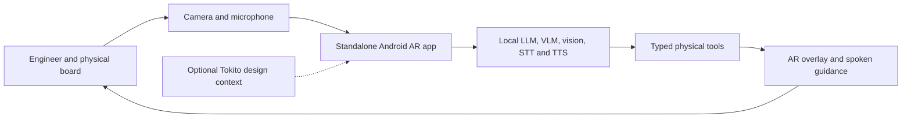

# Tokito Physical Runtime

An offline, on-device AR assistant for electronics engineering. It detects and
tracks a board through the phone camera, reasons locally, speaks and listens
locally, overlays guidance, and produces structured bench observations. Tokito
integration is optional; the application must remain useful without Tokito,
Cloud, or Companion.

This repository is deliberately separate from
[`tokito-companion`](https://github.com/TokitoAI/tokito-companion). Companion is
the mobile review application. This project owns its own standalone Android AR
application and reusable runtime libraries. A future Companion integration may
consume the stable Android interface, but Companion is not the host or a
runtime dependency. No Companion changes are part of this phase.

## Product boundary

The product owns:

- lightweight continuous camera tracking and board registration;
- event-driven region-of-interest capture and specialized visual inference;
- an entirely local text LLM and bounded local vision-language inference;
- wake word, English speech-to-text, measurement parsing, and English
  text-to-speech, all on-device;
- a standalone camera-first AR interface with registered overlays and local
  conversational state;
- typed physical observations with confidence, provenance, and evidence;
- bench tools such as component location, inspection, LED-state reading,
  measurement requests, assembly verification, and change verification;
- model packaging, hardware capability detection, thermal scheduling, and
  reproducible on-device evaluation.

It does not require Tokito's design reasoning or any cloud service. It does not
edit schematics or turn Companion into a CAD application.



## Current status

The repository now includes a standalone Android application plus executable
offline voice, deterministic measurement, and dialogue libraries. The voice
slice provides microphone capture, streaming English speech recognition, local
English speech synthesis, typed partial/final transcript events, audio focus,
cancellation, and barge-in. Final transcripts can enter locale-explicit
electrical measurement parsing with bounded spoken/touch confirmation before a
reading becomes evidence. The dialogue slice uses pinned llama.cpp and the
official Qwen3-0.6B Q8_0 GGUF admitted through a verified local manifest,
bounded local generation, exact typed outcomes, and deterministic tool-policy
validation. The validation app executes its declared `request_measurement`
capability through the deterministic session and responds through local TTS.
Camera, perception, other physical tools, and AR guidance remain tracked work;
their absence is not hidden behind placeholder capabilities.

The voice and dialogue candidates have passed JVM tests and Android arm64
assembly. Target-device performance, schema reliability, and release-signing
remain acceptance gates and are not claimed complete until measured on the
exact iQOO device.

The repository also contains the fail-closed native core, Android lifecycle and
capability API, device-profile evidence, and executable corpus-governance
tooling merged on the runtime-foundation path.

## Documentation

- [Technical Bible](docs/TECHNICAL_BIBLE.md) - normative engineering contract
- [Architecture](docs/ARCHITECTURE.md) - components, deployment, and data flow
- [Product scope](docs/PRODUCT_SCOPE.md) - user outcomes and non-goals
- [Runtime contract](docs/RUNTIME_CONTRACT.md) - tools and observation envelope
- [Model strategy](docs/MODEL_STRATEGY.md) - composed pipeline and deployment policy
- [Offline voice runtime](docs/VOICE_RUNTIME.md) - executable STT/TTS slice and verification
- [Local dialogue runtime](docs/DIALOGUE_RUNTIME.md) - executable LLM and constrained planner slice
- [Measurement runtime](docs/MEASUREMENT_RUNTIME.md) - deterministic parsing and confirmation contract
- [Evaluation](docs/EVALUATION.md) - datasets, metrics, and release gates
- [Corpus governance](docs/CORPUS_GOVERNANCE.md) - immutable manifests, leakage audits, and revisions
- [Security and privacy](docs/SECURITY_AND_PRIVACY.md) - camera/audio trust boundary
- [Delivery gates](docs/DELIVERY_GATES.md) - evidence required for each milestone
- [Evidence manifests](docs/EVIDENCE_MANIFESTS.md) - machine-readable model, corpus, evaluation, security, and release records
- [CI/CD](docs/CI_CD.md) - pull request flow, current CI checks, and branch-policy status
- [Architecture decisions](docs/decisions/) - durable decisions and rationale

## Build and verify

```powershell
$env:ANDROID_HOME = "$env:LOCALAPPDATA\Android\Sdk"
.\gradlew.bat testDebugUnitTest lintDebug assembleDebug
```

The debug APK is written to `app/build/outputs/apk/debug/app-debug.apk`.
The test application initializes only admitted, verified local model bundles;
recognition, dialogue, and synthesis never fetch models at runtime.

## Implementation shape

Python is reserved for dataset preparation, training, export, evaluation, and a
reference harness. The shipping phone hot path will be an Android-native
application plus reusable libraries with Kotlin orchestration and
benchmark-selected native inference backends. Model execution, dialogue,
camera perception, speech, and AR guidance remain local after model
installation. This avoids embedding a general Python interpreter in the camera
and audio lifecycle without measured justification.

## License

MIT - see [LICENSE](LICENSE).
