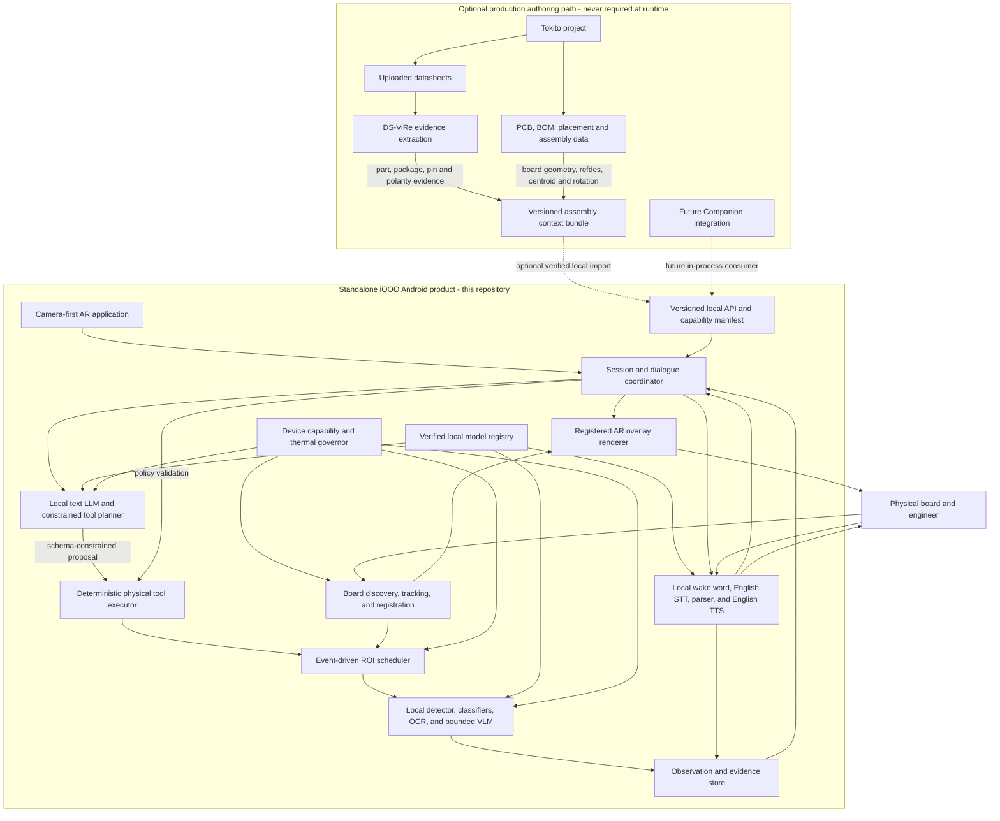

# Architecture

## System boundary

## Deployable artifacts

The repository is organized to produce:

1. a standalone camera-first Android AR application;
2. an Android AAR exposing reusable Kotlin APIs and lifecycle integration;
3. native runtime libraries selected by ABI and inference backend;
4. signed, digest-addressed model bundles for text LLM, visual models, English
   speech, and supporting models, with provenance manifests;
5. a Python development package for training, export, evaluation, and reference
   conformance only;
6. reproducible benchmark reports and a machine-readable capability manifest.

The reusable lifecycle foundation currently lives in `android/runtime`; the
registered presentation API lives in `android/ar-runtime`; and
`android/ar-demo` is a standalone manual-registration conformance host. The
demo is test tooling, not a substitute for automatic board discovery.

## Runtime layers

### 1. Device layer

Discovers camera formats, available accelerators, supported operators, memory,
thermal state, and audio capabilities. It chooses only a benchmarked execution
profile and reports degraded modes explicitly.

### 2. Continuous perception layer

Owns CameraX lifecycle, exposure/focus stabilization, frame timestamps,
automatic PCB/board discovery, lightweight feature tracking, board
registration, change detection, and coordinate transforms. It cannot invoke a
heavyweight model on every frame.

### 3. Event inference layer

Accepts a bounded ROI, task, deadline, and cancellation token. It performs
task-specific preprocessing and inference, then emits calibrated candidates and
evidence. Backpressure is latest-useful-work, not an unbounded frame queue.

### 4. Voice layer

Runs wake-word detection, voice activity detection, streaming English STT,
deterministic measurement parsing, and interruptible English TTS. Raw audio is
ephemeral unless the user explicitly enables a diagnostic capture.

### 5. Local dialogue and reasoning layer

Runs a quantized local text LLM with bounded context and schema-constrained
tool proposals. It combines local conversation, observation summaries, and
optional imported design context. Deterministic policy, not the LLM, authorizes
tools, validates units and arguments, enforces deadlines, and decides whether
an observation is sufficient. The baseline path has no remote fallback.

### 6. Physical tool layer

Validates tool arguments against session context and declared capabilities,
coordinates camera/audio operations, enforces deadlines, and returns exactly one
terminal result: observation, abstention, cancellation, or typed error.

### 7. AR presentation layer

Renders board acquisition, tracking quality, component targets, regions,
warnings, confidence, and step guidance over the live camera view. Rendering
consumes the canonical coordinate-frame graph and never invents independent
pixel transforms. Touch and speech are equal local interaction paths.

The renderer consumes immutable, sequence-ordered scenes through a bounded
single-slot mailbox. Every primitive carries a coordinate frame, transform
revision, observation time, expiry, and uncertainty. Scene projection is
suppressed when any required edge is missing, expired, non-invertible, or from
a different revision. Lifecycle suspension invalidates both registration and
pending scenes. See [AR_RUNTIME.md](AR_RUNTIME.md).

### 8. Evidence layer

Maintains bounded session state: observations, coordinate frames, model/runtime
provenance, and user-confirmed measurements. It stores derived evidence by
default, not continuous raw media.

## Process and thread model

- Android lifecycle and public callbacks run on the application-managed main
  thread only where required.
- Camera acquisition never blocks on inference.
- Tracking uses a dedicated bounded worker and drops stale frames.
- Heavy inference uses a small scheduler with one active accelerator task per
  backend unless profiling proves safe concurrency.
- Audio capture and TTS are independently cancellable; TTS yields immediately
  to barge-in speech.
- Text LLM generation is cancellable, memory-bounded, and serialized against
  accelerator workloads according to the active device profile.
- Tool requests carry deadlines and structured cancellation.
- Observation delivery is ordered per session and idempotent by observation ID.

## Coordinate spaces

Every visual result declares its coordinate frame. Required spaces are sensor,
upright image, preview, ROI, registered board plane, and optional design/PCB
coordinates. Transforms include source/destination frame IDs, calibration
revision, timestamp, and uncertainty. A box without a frame ID is invalid.

## Integration policy

The primary integration surface is the standalone Android application using
the runtime in-process. It requires neither a local HTTP server nor Python IPC.
An imported Tokito design package or future authenticated transport may add
design context, but loss or absence of that integration cannot disable generic
board discovery, local conversation, inspection, or AR guidance. A future
Companion change consumes the reusable API only after the standalone product
passes its hardware gates.

The integration boundary is a versioned **assembly context bundle**, not a live
dependency on Tokito or DS-ViRe. Tokito owns design identity, BOM, board
geometry, reference designators, placements, and rotations. DS-ViRe contributes
source-grounded datasheet facts such as package constraints, pin-one and
polarity evidence. The physical runtime owns camera registration, physical
observations, dialogue, guidance, and abstention. It must never infer a board
placement from a datasheet or overwrite design truth with a visual guess.

See [RUNTIME_CONTRACT.md](RUNTIME_CONTRACT.md) for the external contract and
[decisions/](decisions/) for rationale.
