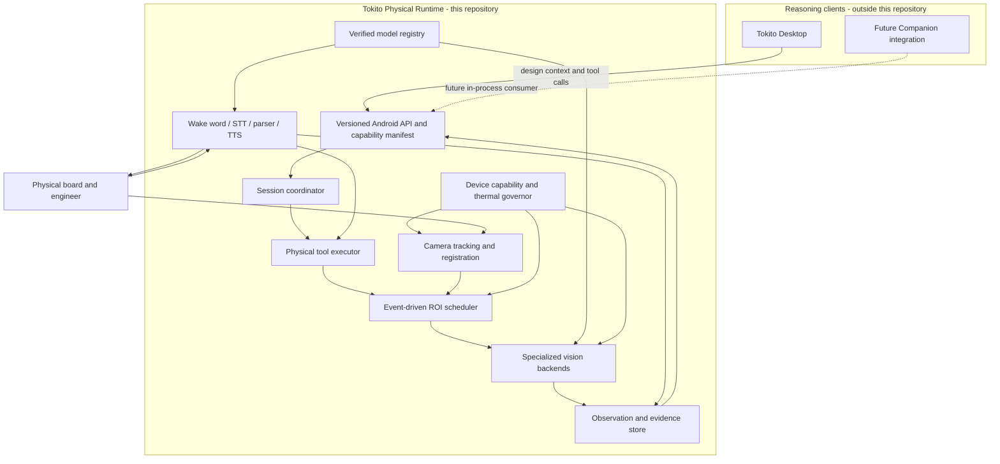

# Architecture

## System boundary

## Planned deployable artifacts

The repository will eventually produce:

1. an Android AAR exposing a Kotlin API and lifecycle integration;
2. native runtime libraries selected by ABI and inference backend;
3. signed, digest-addressed model bundles with provenance manifests;
4. a Python development package for training, export, evaluation, and reference
   conformance only;
5. reproducible benchmark reports and a machine-readable capability manifest.

No artifact exists at bootstrap. File names and package coordinates become
normative only through the runtime-foundation epic and an accepted ADR.

## Runtime layers

### 1. Device layer

Discovers camera formats, available accelerators, supported operators, memory,
thermal state, and audio capabilities. It chooses only a benchmarked execution
profile and reports degraded modes explicitly.

### 2. Continuous perception layer

Owns CameraX lifecycle, exposure/focus stabilization, frame timestamps,
lightweight feature tracking, board registration, change detection, and
coordinate transforms. It cannot invoke a heavyweight model on every frame.

### 3. Event inference layer

Accepts a bounded ROI, task, deadline, and cancellation token. It performs
task-specific preprocessing and inference, then emits calibrated candidates and
evidence. Backpressure is latest-useful-work, not an unbounded frame queue.

### 4. Voice layer

Runs wake-word detection, voice activity detection, streaming STT, deterministic
measurement parsing, and interruptible TTS. Raw audio is ephemeral unless the
user explicitly enables a diagnostic capture.

### 5. Physical tool layer

Validates tool arguments against session context and declared capabilities,
coordinates camera/audio operations, enforces deadlines, and returns exactly one
terminal result: observation, abstention, cancellation, or typed error.

### 6. Evidence layer

Maintains bounded session state: observations, coordinate frames, model/runtime
provenance, and user-confirmed measurements. It stores derived evidence by
default, not continuous raw media.

## Process and thread model

- Android lifecycle and public callbacks run on the application-managed main
  thread only where required.
- Camera acquisition never blocks on inference.
- Tracking uses a dedicated bounded worker and drops stale frames.
- Heavy inference uses a small scheduler with one active accelerator task per
  backend unless profiling proves safe concurrency.
- Audio capture and TTS are independently cancellable; TTS yields immediately
  to barge-in speech.
- Tool requests carry deadlines and structured cancellation.
- Observation delivery is ordered per session and idempotent by observation ID.

## Coordinate spaces

Every visual result declares its coordinate frame. Required spaces are sensor,
upright image, preview, ROI, registered board plane, and optional design/PCB
coordinates. Transforms include source/destination frame IDs, calibration
revision, timestamp, and uncertainty. A box without a frame ID is invalid.

## Integration policy

The first integration surface is in-process Android API, not a local HTTP server
and not Python IPC. Desktop or cloud transport is owned elsewhere. A future
Companion change consumes this API only after the contract and runtime pass the
standalone hardware gates.

See [RUNTIME_CONTRACT.md](RUNTIME_CONTRACT.md) for the external contract and
[decisions/](decisions/) for rationale.
