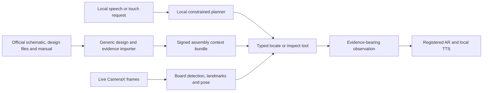

# FRDM-MCXN236 standalone validation

## Purpose

Validate the physical-assistance loop on a real NXP FRDM-MCXN236 before the
Tokito exporter exists. The result must exercise the same contracts intended
for arbitrary supported projects; it is not permission to encode a demo board
inside application logic.

Official inputs are the
[NXP FRDM-MCXN236 product page](https://www.nxp.com/design/design-center/development-boards-and-designs/FRDM-MCXN236),
its published SPF-90828 schematic, FRDM-MCXN236 design-file archive, UM12041
user manual, and the exact revision printed on the physical board. NXP may
require an account for design downloads. Each artifact is retained only as its
license permits and recorded by source URL, revision, retrieval date, and
digest.

## What this proves

- automatic discovery and stable registration of the real board;
- transformation from authored board coordinates to the live camera preview;
- local requests such as `locate D1`, `show U1 pin 1`, or `identify the RGB
  LED` resolving through typed tools;
- correct registered highlight, direction/orientation guidance, spoken output,
  evidence, confidence, and abstention;
- fully local execution on the target iQOO device with networking blocked.

It does not, by itself, prove assembly on an unpopulated PCB. A stock
FRDM-MCXN236 is already assembled. Placement assistance must therefore be
reported as localization/orientation guidance unless a legally sourced bare or
partially assembled board is tested. The evaluation report must not relabel a
populated-board localization test as assembly verification.

## Generic import path

1. Verify the physical board revision against official NXP material.
2. Import board outline, side, reference designators, centroids, rotations,
   footprints, and landmarks from the official design package.
3. Attach package, pin-one, polarity, and electrical evidence from official
   documents using source locators and digests.
4. Validate units, coordinate handedness, rotations, duplicate references,
   missing evidence, and bundle integrity.
5. Emit the versioned assembly context bundle defined by the runtime contract.

No fixed preview coordinate, recorded detection, fabricated confidence, or
`FRDM-MCXN236` conditional is acceptable. Board-specific content belongs in the
bundle and evaluation fixtures. Model outputs must come from actual local
inference, and insufficient evidence must produce abstention.

## Runtime path

## Capture and split discipline

Record multiple sessions on the physical device across distance, in-plane
rotation, perspective, lighting, glare, partial occlusion, background clutter,
and board movement. All frames from one capture session stay in one split.
Development captures cannot appear in the held-out test sessions. Natural
board landmarks are preferred; an explicit assisted-calibration fallback may
exist, but its use must be surfaced and scored separately.

## Acceptance evidence

- board acquisition success and time-to-stable-track;
- held-out reprojection and physical alignment error;
- tracking loss, false lock, and reacquisition rates;
- correct reference localization and orientation/polarity guidance;
- open-set and low-quality abstention rather than confident misidentification;
- speech/tool-selection accuracy and invalid-tool rate;
- end-to-end p50/p95 latency, frame pacing, peak memory, storage, and a
  sustained thermal trace;
- a network-blocked run proving no remote inference or speech dependency;
- immutable run manifest containing source, bundle, model, preprocessing,
  runtime, device, and evaluation digests.

Passing requires declared numeric thresholds frozen before the held-out run.
A hand-selected recording or visually convincing overlay is supporting media,
not the acceptance result.
