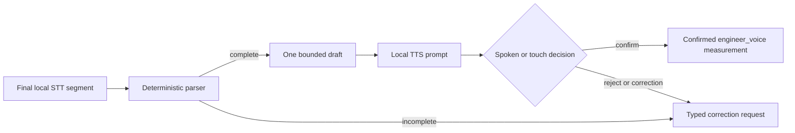

# Deterministic measurement runtime

## Boundary

`measurement-runtime` converts a final English STT transcript into either a
typed electrical measurement draft or a typed incomplete result. It is a pure,
deterministic Kotlin library: no network, model, database, Android clock, or LLM
participates in numeric normalization.

Supported quantities are voltage, current, resistance, capacitance,
inductance, frequency, and power. Every unit maps to an explicit SI multiplier.
The parser preserves the original transcript, exact source span, decimal value,
unit, normalized SI value, optional board relationship, confidence,
alternatives, and ambiguity reasons.

## Flow



Partial STT hypotheses never enter the parser. The default runtime policy
requires a board relationship and confirmation for every reading. A confirmed
record includes a monotonic confirmation timestamp and source
`ENGINEER_VOICE`; a draft is never evidence.

## Locale and ambiguity

The decimal convention is configuration, not inference. Under `DOT`, `1,000.5`
is one thousand and one half; under `COMMA`, `1.000,5` has the same value. A
single separator that conflicts with the configured convention is retained as
a decimal candidate and marked `DECIMAL_SEPARATOR`, forcing confirmation.

Ranges, explicit corrections, multiple readings, low STT confidence, and a
missing required relationship also force confirmation. Missing values or
units, unsupported units, contradictory quantities, scientific notation, and
values outside the configured SI bound produce an incomplete result and a
recoverable prompt.

## Verification

```powershell
$env:ANDROID_HOME = "$env:LOCALAPPDATA\Android\Sdk"
.\gradlew.bat :measurement-runtime:testDebugUnitTest :voice-runtime:testDebugUnitTest lintDebug assembleDebug
```

The JVM suite covers numerical and spoken decimals, SI prefixes, case-sensitive
`MΩ`/`mΩ`, locale grouping, negative values, ranges, corrections,
contradictory quantities, unsupported units, overflow, relationship policy,
determinism, spoken confirmation/rejection, touch confirmation, and the final
STT-to-local-TTS session bridge. Recorded-noise accuracy and device latency
remain hardware evidence gates; unit tests do not substitute for them.
