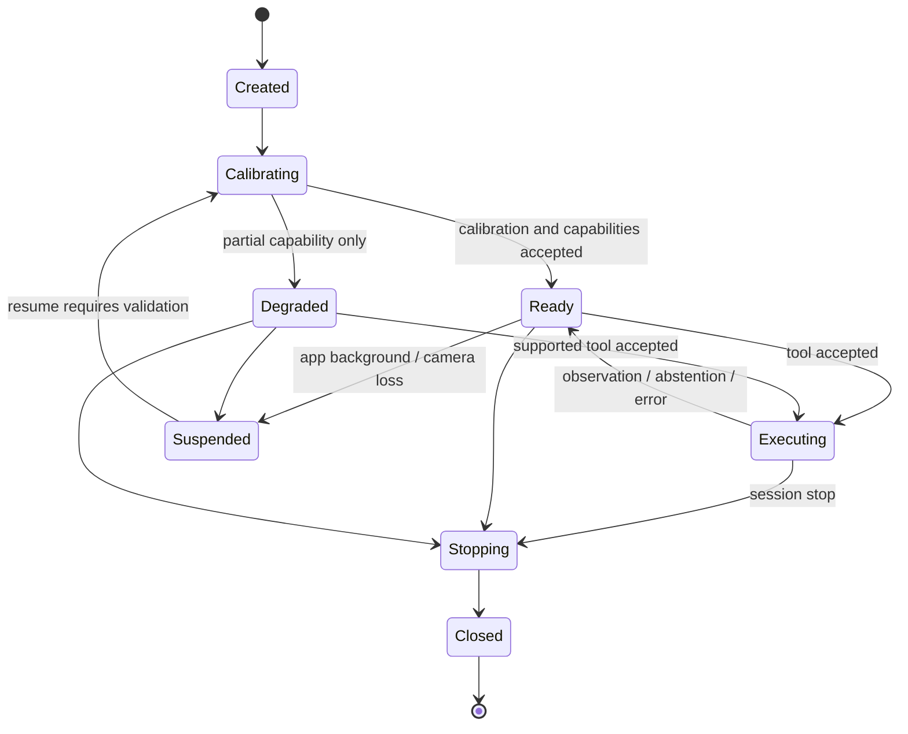

# Tokito Physical Runtime Technical Bible

**Status:** Normative architecture and quality contract.

**Scope:** Standalone on-device AR, local reasoning, vision, speech,
observations, and physical bench tools.

**Out of scope:** Companion UI changes and product implementation at bootstrap.

## 1. Mission

The product is a complete offline physical assistant on the iQOO phone. An
engineer places a PCB in the camera workspace; the application discovers and
tracks it, reasons locally, converses locally, executes bounded perception and
interaction tools, and renders registered AR guidance. Tokito design context
may enrich the session but cannot be required for baseline operation.

The governing equation is:

```text
optional design context + local dialogue/tool request + bounded sensor evidence
    -> typed observation or typed abstention + local AR/spoken guidance
```

Natural-language confidence is never a substitute for a typed result.

## 2. System invariants

1. Raw continuous camera and microphone streams remain on-device by default.
2. Heavy inference is event-driven and bounded by ROI, task, deadline, and
   cancellation.
3. Every identity-sensitive observation carries confidence, coordinate frame,
   evidence, model provenance, and calibration revision.
4. Below an accepted operating threshold, the runtime abstains.
5. Tool execution cannot edit a design, energize hardware, or claim a human
   measurement that was not actually supplied.
6. Continuous acquisition never waits for model inference.
7. Queues are bounded; stale frames and superseded requests are discarded.
8. Model artifacts are hash-addressed, signature-verified, licensed, and
   activated atomically with rollback.
9. Unsupported hardware/backends/features are absent from the capability
   manifest or return a typed unsupported error.
10. A release is defined by measured evidence on a declared physical device,
    not by a successful desktop simulation or demo.
11. Baseline operation requires no network, Tokito installation, Companion,
    cloud inference, cloud speech, or remote reasoning service.
12. Local generative-model output cannot bypass typed tools, deterministic
    measurement parsing, confidence gates, or evidence requirements.

## 3. Runtime boundary

The standalone application owns a local dialogue and planning loop, AR
presentation, session context, and physical tool calls. It emits structured
observations, progress, and guidance events. The local text LLM may select and
sequence declared tools; deterministic policy validates every invocation and
result. An optional external client may supply design context but does not own
the baseline reasoning loop.

For authored projects, Tokito is authoritative for schematic/PCB identity,
BOM, reference designators, placement, and rotation. DS-ViRe is authoritative
only for source-grounded datasheet evidence such as package, pin, polarity, and
electrical facts. They are joined into an immutable assembly context bundle.
The runtime is authoritative for live camera registration and physical
observations. A datasheet is never a source of board placement coordinates.

The runtime must not:

- require an external reasoning client for baseline use;
- infer or mutate schematic intent;
- send unbounded media through Companion or Cloud;
- silently fall back to a different model/backend;
- synthesize a measurement value from vision or language context;
- return component identity without board-registration evidence or a declared
  generic-class result;
- expose implementation exceptions across the public API.

The standalone AR shell presents the live camera preview, board acquisition
state, registered overlays, tool progress, confidence or abstention, local
chat, and speech state. Overlays use the same versioned coordinate transforms
as observations; presentation code cannot maintain a second geometry truth.

## 4. Session model

A physical session binds:

- a stable session ID;
- an optional design/project identity and immutable context revision;
- the physical board instance or an explicit unbound-board mode;
- device and runtime capability profile;
- camera calibration and current board registration;
- active model bundle manifest;
- bounded observation history and privacy policy.
- local dialogue history bounded by the active memory budget.

State transitions:



Resume never assumes the previous camera transform remains valid. Registration
must be revalidated after lifecycle interruption, camera change, significant
motion, zoom/lens switch, or thermal/backend reconfiguration.

## 5. Camera and continuous perception

The continuous path performs only work that fits the frame budget:

- timestamp and orientation normalization;
- exposure/focus state observation;
- lightweight board/feature tracking;
- registration confidence update;
- change detection and ROI invalidation;
- preview guidance primitives.

It produces no heavyweight semantic answer. Frames use a bounded latest-frame
buffer. If processing lags, intermediate frames are dropped and the dropped
count is observable.

Camera configuration is selected from measured device profiles. The baseline
target is a stable 30 fps preview. Higher resolution still capture is allowed
for explicit ROI requests. Lens switching is a calibration boundary.

## 6. Registration and coordinate integrity

The runtime must distinguish:

- generic visual recognition: "a resistor";
- registered design identity: "R14";
- uncertain candidates: ranked references with evidence;
- abstention: insufficient registration or discriminative evidence.

Design identity requires a valid transform from image evidence to a board/design
frame plus context matching. Each result records transform revision and
uncertainty. If registration confidence falls below the accepted threshold, all
design-identity tools pause or abstain; generic visual tools may remain
available with an explicit unbound identity.

## 7. Event-driven visual inference

### Metric 3D digital twin

An optional 3D PCB asset is bound to the immutable assembly-context revision,
board origin, metric units, axes, bounds and content digest. The renderer
accepts only a validated GLB 2 package and uses the current camera calibration
and board-pose revision; it does not infer scale from a screen rectangle. Stale,
low-confidence or context-mismatched registration suppresses the model. A
calibration object may prove renderer conformance but is never substituted for
a missing project asset. Asset production is independent from runtime control
flow and cannot introduce board-name branches.

An inference request contains task type, ROI, source frame revision, context,
deadline, required confidence, and cancellation token. Processing stages are:

1. validate session capability and registration requirements;
2. acquire or select a sharp, exposure-valid ROI;
3. normalize with versioned preprocessing;
4. execute the task-specific model/backend;
5. calibrate scores and apply geometric/context constraints;
6. assemble evidence and provenance;
7. emit observation or abstention;
8. discard late results if session/request revision changed.

The initial visual capability families are component localization, component
presence/package/orientation inspection, LED state/blink observation, and
bounded assembly comparison. Package families are declared in the capability
manifest; "all components" is not a valid capability.

## 8. Voice runtime

The voice path is wake-word activated and local:

```text
audio -> VAD/wake word -> streaming STT -> local dialogue orchestrator
      -> response / typed tool proposal / deterministic measurement parser
      -> typed voice observation when a measurement is confirmed
```

TTS is generated locally, interruptible, and independent from STT. Barge-in
stops or ducks TTS before speech capture is interpreted. Echo suppression and
audio focus behavior are part of device acceptance.

A measurement parser must preserve:

- original transcript;
- normalized numeric value using decimal arithmetic;
- unit and SI scale;
- measurement relationship (for example TP1 to GND);
- explicit source `engineer_voice`;
- parser confidence and alternatives;
- confirmation state when ambiguity exists.

It must reject or request confirmation for missing units, ambiguous decimal
separators, range statements, contradictory tokens, unsupported units, and
implausible overflow. The local text LLM may propose intent and tool candidates,
but final numeric normalization and tool authorization are deterministic and
testable. Network-backed speech or language inference is not a baseline mode.

## 9. Physical tools

The baseline tools are:

- `locate_component`
- `inspect_component`
- `read_led_state`
- `request_measurement`
- `verify_assembly`
- `verify_change`

Tools are capability-negotiated and versioned. Each call is idempotent by tool
call ID, deadline-bounded, and cancellable. Each returns one terminal outcome:

- `observation`
- `abstained`
- `cancelled`
- `error`

Progress is advisory and cannot replace the terminal outcome. Full schemas and
error semantics are in [RUNTIME_CONTRACT.md](RUNTIME_CONTRACT.md).

## 10. Structured observations and evidence

Every observation includes:

- globally unique observation ID and originating tool-call ID;
- session and immutable context revision;
- monotonic and wall-clock timestamps;
- observation type and source;
- confidence and calibration method;
- coordinate frame/transform revision where visual;
- typed payload;
- evidence references and digests;
- runtime, model, preprocessing, backend, and device provenance;
- warnings, degradation, and confirmation requirements.

Continuous raw frames/audio are not observation history. Evidence is the
minimum bounded material needed to audit the result: a cropped ROI, compact
feature/transform metadata, or transcript segment according to privacy policy.

## 11. Model and backend policy

The system is a composed, entirely local pipeline, not one general model.
Classical CV and small learned tracking may own continuous work. Specialized
detectors, classifiers, OCR/marking recognition, and a bounded local VLM handle
visual events. A local text LLM owns conversational interpretation and tool
planning behind deterministic policy. Voice uses separate wake-word, English
STT, parser, and English TTS components. All required weights and tokenizers are
available on-device after installation or explicit model provisioning.

Backend selection is evidence-driven. Candidate Android paths may include
vendor NPU, NNAPI, GPU, or CPU runtimes, but no backend is promised until the
target iQOO device profile passes operator coverage, correctness, latency,
memory, thermal, and lifecycle tests.

Python owns training, export, corpus tooling, and reference conformance. The
shipping hot path uses Android-native orchestration and native inference. See
[MODEL_STRATEGY.md](MODEL_STRATEGY.md) and ADR 0003.

## 12. Scheduling, backpressure, and thermal behavior

- One request cannot allocate an unbounded image/audio history.
- The scheduler limits concurrent accelerator work by measured device profile.
- Interactive requests outrank background verification but cannot starve
  lifecycle/cleanup work.
- Deadlines propagate to capture, preprocessing, inference, and postprocessing.
- Thermal degradation reduces capture/inference frequency or capability and is
  emitted as a state change; it never silently changes accuracy thresholds.
- Out-of-memory risk causes preflight rejection or controlled degradation, not
  process death.

## 13. Initial acceptance budgets

These are initial release gates, not benchmark claims. They may change only via
an ADR with recorded device evidence.

| Property | Initial gate on declared target device |
|---|---|
| Preview and tracking | Stable 30 fps; p95 continuous processing <= 16 ms/frame |
| ROI acquisition | p95 <= 150 ms after accepted tool request |
| Visual event result | p95 <= 1.5 s for baseline supported task |
| Wake to partial STT | p95 <= 500 ms |
| End of speech to final STT | p95 <= 1.2 s |
| TTS time to first audio | p95 <= 400 ms |
| Local LLM first token | p95 <= 800 ms for baseline prompt/tool schema |
| Local LLM generation | sustained >= 8 tokens/s for baseline profile |
| AR overlay | p95 motion-to-overlay update <= 100 ms while tracking is valid |
| Runtime peak RSS | <= 3.0 GiB during baseline mixed AR/voice/LLM session |
| Model bundle | <= 3.0 GiB installed baseline bundle |
| Sustained operation | 20-minute scenario completes without crash or severe sustained throttling |
| Offline operation | Baseline session succeeds with network disabled |

## 14. Initial quality gates

Metrics apply only to held-out physical boards and sessions with published
support boundaries.

| Capability | Initial gate |
|---|---|
| Registered component mapping | precision >= 99.5% at automation threshold; otherwise abstain |
| Supported component presence | macro F1 >= 95% |
| Supported orientation classes | macro F1 >= 90% |
| Static LED state | macro F1 >= 98% |
| Blink frequency | median relative error <= 5% in declared range |
| Spoken measurement structured parse | exact match >= 97% clean and >= 92% recorded bench noise |
| Registration | median normalized reprojection error <= 0.5% of frame diagonal |

All gates also report per-board results, abstention rate, false identity rate,
confidence calibration, and failure categories. Accuracy cannot be improved by
silently excluding unsupported or difficult samples after evaluation begins.

## 15. Failure semantics

Errors are typed and stable. At minimum: invalid argument, unsupported
capability, permission denied, lifecycle unavailable, registration lost,
capture quality insufficient, deadline exceeded, cancelled, thermal limited,
model unavailable/integrity failure, backend failure, and internal invariant
violation.

Abstention is not an internal error. It includes reason, recoverable guidance,
and candidate evidence when safe. Exceptions and native crashes never cross the
public boundary as success or unstructured strings.

## 16. Privacy and security

Camera and microphone access is session-scoped and visibly active. Raw media is
ephemeral by default. Diagnostic capture is opt-in, time-bounded, reviewable,
and stored in app-private encrypted storage with explicit deletion.

Model bundles require manifest verification before activation. Rollback uses a
previous verified bundle. Untrusted design context, tool arguments, transcripts,
and model outputs are size-limited and validated. See
[SECURITY_AND_PRIVACY.md](SECURITY_AND_PRIVACY.md).

## 17. Versioning and compatibility

The public Android API, tool schema, observation schema, model manifest, and
benchmark manifest are independently versioned. A capability handshake reports
supported major/minor versions and feature flags. Unknown required fields or
major versions fail closed. Optional additive fields preserve compatibility.

No consumer is expected to inspect internal model tensors or backend-specific
types.

## 18. Release definition

A release requires:

1. reproducible build and signed/digest-verified artifacts;
2. clean automated unit, contract, integration, and model tests;
3. held-out corpus report with leakage audit;
4. target-device accuracy, latency, memory, battery/thermal, lifecycle, and
   offline reports;
5. camera/audio privacy review;
6. failure-injection and model rollback evidence;
7. end-to-end standalone AR bench scenarios with all networking disabled;
8. updated capability and support matrix;
9. no critical/high unresolved release-blocking issue.

Passing a hackathon demo is evidence for a scenario, not a substitute for these
release gates.
