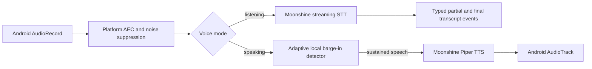

# Offline voice runtime

## Implemented boundary

The `voice-runtime` Android library owns local English streaming recognition,
local English synthesis, microphone capture, Android audio focus, transcript
events, synthesis queueing, cancellation, and barge-in. The standalone `app`
module is a hardware test surface; Companion is not involved.

The current measured candidate is Moonshine Voice 0.1.5 with:

- the English tiny-streaming STT architecture plus spelling fusion;
- the lightweight `piper_en_US-amy-low` TTS voice;
- 16 kHz mono `VOICE_COMMUNICATION` capture;
- platform acoustic echo cancellation and noise suppression when available.

This pins an implementation candidate, not a release benchmark claim. The exact
iQOO device must still pass issue #8 and the voice gates before the capability
is accepted for release.

## Runtime flow



The recognizer and synthesizer never run through a network API. First-use model
provisioning is an explicit operation. After provisioning, the app records a
complete SHA-256 inventory and verifies the exact files before loading them.
Model files remain in app-private storage and are not committed to Git.

The development provisioner establishes reproducibility and corruption
detection, but it is not the final release-signing mechanism. Gate 7 still
requires a publisher-signed model manifest and immutable release artifact. A
missing or invalid inventory does not expose STT/TTS capability when downloads
are disabled.

## State and failure behavior

- `initialize` loads or explicitly provisions verified local models.
- `startListening` obtains exclusive capture focus and begins one bounded audio
  stream.
- partial hypotheses and final segments are distinct typed events.
- `speak` supports queue, replacement, and busy rejection policies.
- synthesis pauses recognition; capture remains local and becomes the barge-in
  signal path only when echo cancellation is active.
- speech loss, touch interruption, or detected barge-in stops synthesis and
  restores recognition deterministically.
- permission, focus, model, integrity, capture, recognition, synthesis,
  cancellation, and state failures have stable error codes.

Raw audio and synthesized samples are not persisted by this implementation.

## Model provenance and licensing

- Moonshine Voice runtime and English streaming STT are sourced from
  [moonshine-ai/moonshine](https://github.com/moonshine-ai/moonshine). The
  upstream project identifies its code and English STT models as MIT licensed.
- `piper_en_US-amy-low` originates in the
  [Piper voice collection](https://huggingface.co/rhasspy/piper-voices/tree/main/en/en_US/amy/low).
  Its model card traces the training source to Mycroft Mimic 3 voices; that
  source repository is CC BY-SA 4.0. Release packaging must retain the required
  attribution and license notices.

The application downloads these artifacts only during explicit provisioning;
they are not stored in this Git repository. A release manifest must pin the
exact upstream revision, file digests, attribution text, and license for every
distributed model artifact.

## Development verification

```powershell
$env:ANDROID_HOME = "$env:LOCALAPPDATA\Android\Sdk"
.\gradlew.bat testDebugUnitTest lintDebug assembleDebug
```

The test APK is generated under `app/build/outputs/apk/debug/`. Models are
downloaded only after the user selects **Provision & initialize**. A real-device
acceptance run additionally records model inventory digest, device profile,
WER/entity accuracy, first-partial/final latency, TTS first-audio latency,
barge-in latency, memory, and sustained thermal behavior.
