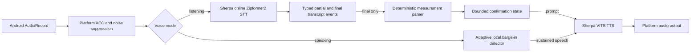

# Offline voice runtime

## Implemented boundary

The `voice-runtime` Android library owns local English streaming recognition,
local English synthesis, microphone capture, Android audio focus, transcript
events, synthesis queueing, cancellation, and barge-in. The standalone `app`
module is a hardware test surface; Companion is not involved.

`MeasurementVoiceSession` is the typed bridge from final STT segments to the
separate deterministic `measurement-runtime`. It uses local TTS for correction
and confirmation prompts. It does not use the local LLM to normalize numbers,
units, decimal separators, or relationships.

The current executable candidate uses:

- sherpa-onnx 1.13.6 with the English Kroko streaming Zipformer2 transducer;
- the sherpa-onnx VITS path with the LJSpeech medium INT8 voice;
- 16 kHz mono `VOICE_COMMUNICATION` capture;
- platform acoustic echo cancellation and noise suppression when available.

Moonshine Voice 0.1.5 was rejected after physical-device validation produced an
uncatchable `SIGILL` while its bundled ONNX Runtime loaded Piper stages. Both STT
and TTS now use the official sherpa-onnx Android AAR. The build admits that AAR
only after checking the SHA-256 published for release 1.13.6. The app has no
network permission or remote inference fallback. This remains an implementation
candidate until the exact device passes the voice quality and performance gates.

## Runtime flow



The recognizer and synthesizer never run through a network API. They accept only
a pre-provisioned model bundle whose complete SHA-256 inventory matches the
active manifest. A second typed bundle document declares engine kind, language,
model type, model paths, speaker, and speed. Every path is relative, inventory
verified, and canonicalized beneath the bundle root. Model files remain in
app-private storage and are not committed to Git.

Release admission must establish a publisher-signed manifest and immutable
artifacts before the runtime can initialize. A missing, invalid, or unsupported
bundle does not expose either speech capability.

## State and failure behavior

- `initialize` loads verified local models.
- `startListening` obtains exclusive capture focus and begins one bounded audio
  stream.
- partial hypotheses and final segments are distinct typed events.
- `speak` supports queue, replacement, and busy rejection policies.
- synthesis pauses recognition; capture remains local and becomes the barge-in
  signal path only when echo cancellation is active.
- the runtime reports `Synthesizing` while local TTS generates samples and
  reports `Speaking` only after audio playback starts.
- speech loss, touch interruption, or detected barge-in stops synthesis and
  restores recognition deterministically.
- permission, focus, model, integrity, capture, recognition, synthesis,
  cancellation, and state failures have stable error codes.

Raw audio and synthesized samples are not persisted by this implementation.
Unconfirmed measurement drafts are bounded to one in-memory value and are
cleared on confirmation, rejection, invalid input, or cancellation.

## Model provenance and licensing

- Runtime and English streaming STT are sourced from
  [k2-fsa/sherpa-onnx](https://github.com/k2-fsa/sherpa-onnx). The Android AAR is
  pinned to 1.13.6 and digest `0012d9a28f15bd6fb966b62b70a75da3990512fdccce28b83098248ce4be1698`.
- STT uses `sherpa-onnx-streaming-zipformer-en-kroko-2025-08-06`, archive digest
  `c8676e5ff9ac2a85296e53ee0fd4d5fb1db6770e7a7647166eeafe349ade6834`.
- TTS uses `vits-piper-en_US-ljspeech-medium-int8`, archive digest
  `24dc3bd77dd48c291e52c297878d3437c9492f245d823d7f6a06c4bbb67f4b6b`.
  Its embedded model card identifies the LJSpeech dataset as public domain.

Release tooling provisions speech artifacts before runtime initialization; they
are not stored in this Git repository. A release manifest must pin the exact
upstream revision, file digests, attribution text, and license for every
distributed model artifact.

## Development verification

```powershell
$env:ANDROID_HOME = "$env:LOCALAPPDATA\Android\Sdk"
.\gradlew.bat testDebugUnitTest lintDebug assembleDebug
```

The test APK is generated under `app/build/outputs/apk/debug/`. The app fails
closed until a verified local bundle has been admitted. A real-device acceptance
run additionally records model inventory digest, device profile,
WER/entity accuracy, first-partial/final latency, TTS first-audio latency,
barge-in latency, memory, and sustained thermal behavior.
